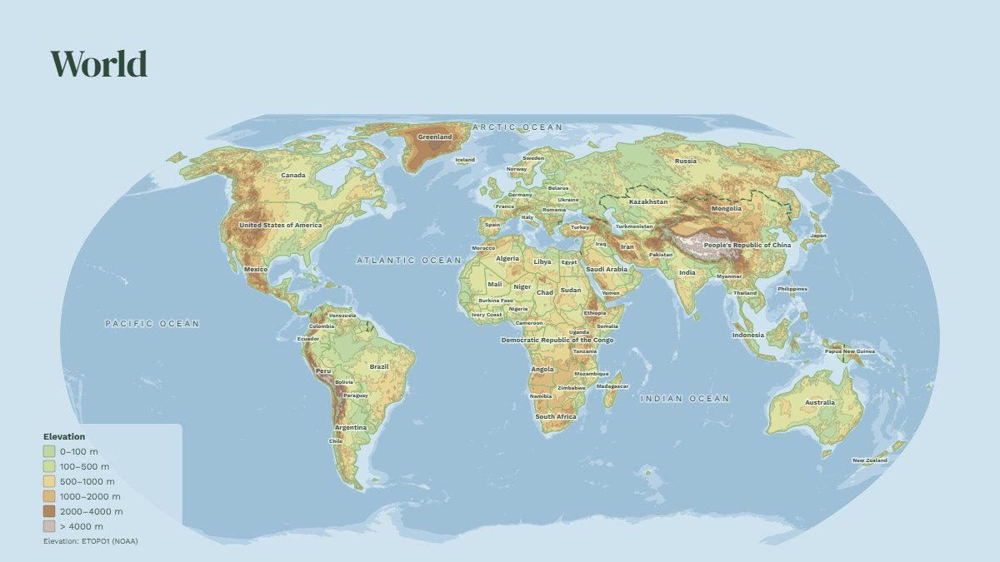
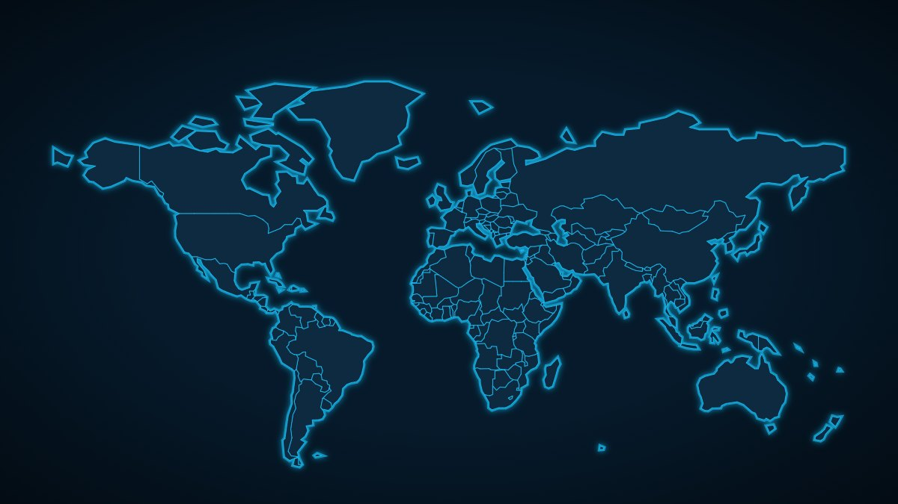
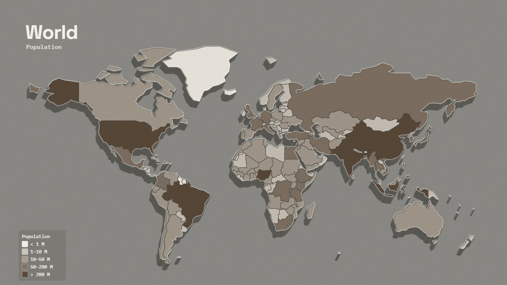
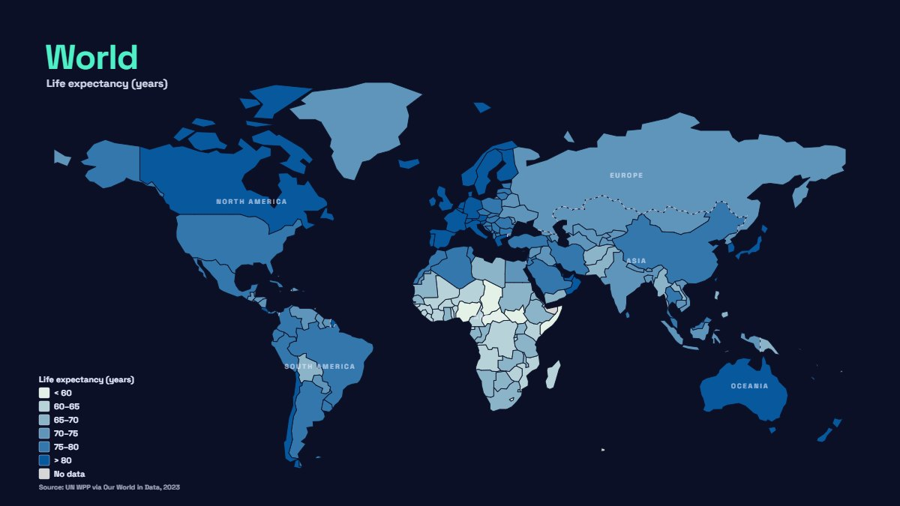
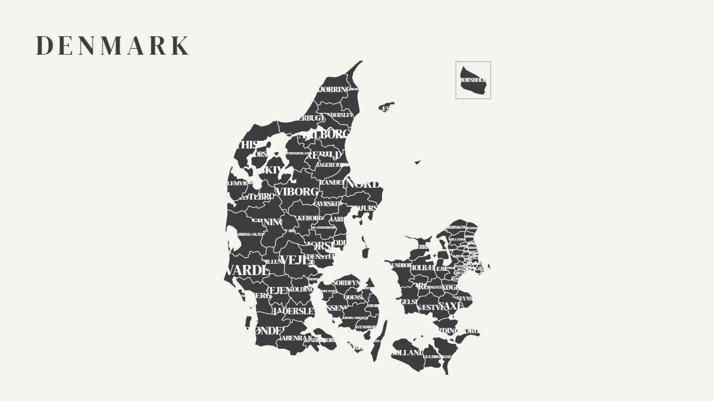
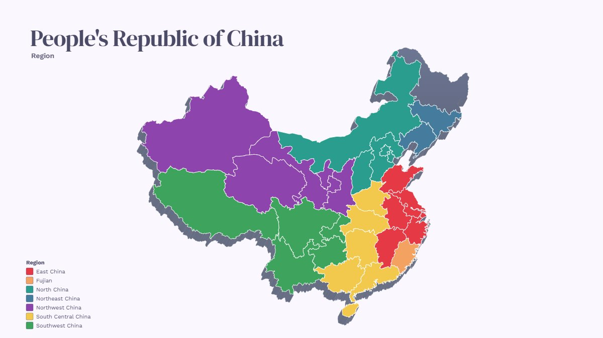

# MoboMap – Map Design Studio

**Live demo: https://morbobon.github.io/MoboMap/** (public build, published to the `gh-pages` branch on every push to `main`)

Single-file, offline-capable generator for stylised maps with highlighted units, in your own design system. Start from **the world (176 countries)** and drill down via **Focus** into any country's **regions/states/provinces** (Natural Earth admin-1, ~240 countries) – or **Denmark's 98 municipalities** in full detail.

- **Workspace** – an icon rail with four tabs (**Map** · **Highlight** · **Look** · **Page**), a **looks strip** under the map with live thumbnails of the current map in every look (24 presets plus your own saved looks; a look sets style, effects and frame, never the profile), one **Export** menu, and **undo/redo** (Ctrl+Z / Ctrl+Y).
- **Design systems / company profiles** as JSON: colours, fonts, logo, partners, footer. Built in, loaded from a sidecar file, or imported in the app. The UI re-themes itself from the active profile.
- **28 map styles** – flat, silhouette, atlas, paper cut, glass, neon, blueprint, halftone, 3D block, slate, poster, retro, **topographic (real elevation)**, doodle, typographic, vintage, word map, midnight, **flag sticker**, **network**, **pixel mosaic**, **stone relief** …
- **Focus / drill-down** – World → continent (zoom) → country (switches to its regions, local equal-area projection, major cities, neighbouring countries in grey for context) → region (zoom). Small far-away islands (e.g. Bouvet, overseas departments) are left out of country views.
- **Far-away parts** – Alaska and Hawaii, the Canary Islands, Madeira and the Azores, Svalbard, French overseas regions, Bornholm …: shown in **inset boxes** (each in its own equal-area projection, placed in the emptiest corner), in place, or hidden (main part only). Detected automatically from distance to the main landmass and share of the area.
- **Zoom and pan** – mouse wheel zooms around the cursor, drag to pan; "Reset zoom" or a new focus resets. Exports and saved projects keep the zoom.
- **Frame** – the thin frame around the page follows the map style or can be switched on/off for any style; the legend stays inside it.
- **Highlight groups** – several groups at once, each with its own colour and modes (solid, hatched, dots, tint, glow, outline, raised, pin, label, callout, dim others).
- **Colour by** – 28 attributes in six categories, or turn any of them into highlight groups with one click:
  - *Geography*: continent, UN region, subregion, hemisphere, area, first letter
  - *Economy*: income group, economy class, GDP per capita, extreme poverty (< $3/day)
  - *Society*: population, life expectancy, Human Development Index, median age, children per woman, internet users, access to electricity, majority religion
  - *Health*: obesity (adults), hunger (undernourishment)
  - *Conflict & politics*: war zones (conflict deaths), political regime, EU / NATO / G20 / Nordic
  - *Environment*: CO₂ per person, renewable electricity
  
  Statistics use fixed classes with sequential colour ramps (red = burden, blue = development), a grey "No data" class and a source line with the data year in the legend.
- **Terrain relief** – elevation bands and contours from ETOPO1 (0.25°, low detail): hypsometric tints in the topographic style, or subtle shading on top of any style (Display → Terrain relief); sea depths too.
- **Projections**: Miller (default for the world), Local (Lambert azimuthal equal-area, default for countries), Robinson, Equal Earth, Natural Earth, Mollweide, Winkel Tripel, Mercator, Plate carrée.
- **Layouts** (landscape, portrait/A4, square, 16:9), footer with partner logos, legend. **Automatic title/subtitle** from the focus, the selection and the "Colour by" attribute; title and subtitle can each be placed top/bottom × left/centre/right.
- **Export** PNG / JPG (3×) and PDF (A4, clickable partner links). **Projects** save/open as `.mobomap.json`.
- **UI in 10 languages** – English (default), Danish, German, French, Spanish, Swedish, Norwegian, Finnish, Dutch, Italian – and **light/dark mode** that follows the operating system, with a switch in the top bar (auto → light → dark).
- **10 design systems** built in – Aurora (dark), Nordic minimal (used by the start project), Sunset, Ocean, Mono / brutalist, Pastel, Tech / dark, Corporate blue, Green and a template – chosen in the top bar.

## Examples

Rendered from the saved projects in [docs/examples](docs/examples) by `npm run examples` (also part of `npm run release`) – open any of them in the app with **Open project**.

<!-- examples:start -->
| | |
|---|---|
|  |  |
| **Topographic** – real elevation (ETOPO1), Robinson · [project](docs/examples/01-world-topographic.mobomap.json) | **Neon** – Tech / dark profile · [project](docs/examples/02-world-neon.mobomap.json) |
|  |  |
| **Stone relief** – colour by population · [project](docs/examples/03-world-population-stone.mobomap.json) | **Regions** – life expectancy (Our World in Data) · [project](docs/examples/04-world-life-expectancy.mobomap.json) |
|  |  |
| **Typographic** – Denmark's 98 municipalities · [project](docs/examples/05-denmark-typographic.mobomap.json) | **3D block** – China, colour by region · [project](docs/examples/06-china-regions-3d.mobomap.json) |
<!-- examples:end -->

Everything ships as one `index.html` (~4.4 MB) that works from `file://` without a server.

## Quick start

```bash
npm install
npm run build        # -> index.html
npm run check        # build + syntax check + i18n coverage (all languages, unused keys) + unused declarations
npm run format       # Prettier on src/ and tools/
npm run release      # -> release/MoboMap-<version>-<date>.zip (+ a -public variant); also re-renders the examples
npm run examples     # README example images from docs/examples/*.mobomap.json (uses installed Chrome/Edge)
node tools/serve.mjs . 8787   # optional local server for development
```

Open `index.html` in a browser. It starts from `src/default-project.json` – a saved project (topographic world, Nordic profile) – so replacing that file with any saved `.mobomap.json` changes the start view. Language, light/dark mode and open panel sections are remembered. To prepare geodata from scratch (only needed if the source files change): `npm run geo`. To refresh the statistics from Our World in Data: `npm run stats`. To rebuild the elevation contours: `npm run elevation`.

## Design systems

A design system is one JSON document. Three ways to add one – same schema:

1. **Build in** – put `name.json` (plus logo/font files) in `designsystems/` and run the build. File names control the order; the first *public* profile is the default. `designsystems/private/` is gitignored for client-specific brands and is tagged "Private" in the app.
2. **Sidecar, no build** – put `designsystems.js` next to `index.html` containing `window.DESIGN_SYSTEMS = [ ... ]`. It loads automatically, also from `file://`. The app can generate this file from your imported profiles.
3. **In the app** – "Import" (or drop a `.json` on the page), or "Edit / new" → JSON editor with logo picker → "Save". Stored in localStorage; "Export JSON" shares it.

Because a `file://` page cannot `fetch()` files from its own folder, logos and fonts in sidecar/imported profiles must be data URIs (the editor and the build do this for you). In `designsystems/`, `src` may be a relative path.

### Schema

```jsonc
{
  "id": "acme",                        // unique key (required)
  "name": { "en": "ACME", "da": "ACME" },  // shown in the dropdown – a string or one text per language
  "note": "brand guide 2026",          // optional
  "fonts": {
    "heading": "Arvo", "body": "Work Sans",        // bundled: Arvo, Work Sans, Roboto Slab, Space Grotesk, DM Serif Display, IBM Plex Mono
    "faces": [{ "family": "MyFont", "src": "fonts/myfont.woff2", "weight": "700" }]   // optional custom fonts
  },
  "colors": {
    "bg": "#FFFFFF", "land": "#2F3E4E", "landAlt": "#3d4f62", "stroke": "#FFFFFF", "ink": "#2F3E4E",
    "primary": "#2F3E4E", "accent": "#FF6B35", "accent2": "#3A86FF",   // UI theme + default highlight colour
    "heading": "#2F3E4E", "headingOnDark": "#FF6B35", "dark": false   // optional
  },
  "highlight": ["#FF6B35", "#3A86FF", "#FFD166", "#FFFFFF"],   // highlight colours offered per group
  "swatches": ["#2F3E4E", "#FF6B35", "#3A86FF"],               // palette preview in the UI
  "company": {
    "name": "ACME", "link": "https://acme.example",            // link is clickable in PDF
    "logo": { "src": "acme/logo.png", "width": 220, "box": "auto", "boxColor": "#2F3E4E", "text": "", "sub": "" }
  },
  "partners": [ { "name": "Partner", "link": "https://…", "logo": "acme/partners/p.png" } ],
  "footer": { "label": "In partnership with",
              "divider": { "style": "bar", "color": "#2F3E4E", "opacity": 0.8, "height": 5, "width": 0.18, "align": "left" } },
  "defaults": { "title": "We are here", "sub": "" }
}
```

Omitted fields are derived (`landAlt`, `accent2`, `dark`, `heading` …). `logo.box`: `auto` draws a box on light/uneven backgrounds, `always`, `never`. Divider styles: `bar` (rounded), `line`, `none`.

**Translatable texts:** `name`, `note`, `company.name`, `company.logo.text`/`sub`, `footer.label` and `defaults.title`/`sub` accept either a plain string or an object per language, e.g. `{ "en": "In partnership with", "da": "I samarbejde med" }`. The UI language picks the entry; missing languages fall back to `en`, then to the first entry. An empty `company.name` (and no logo) means no logo is drawn. `defaults` only apply when "Auto" text is switched off.

## Data

`tools/build.mjs` turns the sources in `assets/geo/` into a generic *dataset* per map: units with code, names (per language), group, centroid, bbox, area and two detail levels, plus landmass, inner borders and group borders.

| Map | Units | Source | Coordinates |
|---|---|---|---|
| Denmark | 98 municipalities, 5 regions, Bornholm inset | DAGI via [geoJSON-Danish-municipalities](https://github.com/magnuslarsen/geoJSON-Danish-municipalities) | UTM 32N, projected at build time |
| World | 176 countries, 6 continents, major cities | [Natural Earth](https://www.naturalearthdata.com/) 110m countries, 50m populated places | lon/lat, projected at runtime |
| Any country | its admin-1 units (states, regions, provinces …), grouped by NE `region` where available | Natural Earth 10m admin-1, simplified to ~3.5 km (`tools/prepare-admin1.mjs`) | 0.01° integers, delta-encoded, decoded on demand |

Denmark uses its municipalities instead of its 5 admin-1 regions. Adding finer detail (admin-2) for another country follows the same pattern: a dataset in `tools/build.mjs` and a branch in `countryData()`.

World attributes come from Natural Earth (continent, UN region, subregion, economy, income group, population, GDP). Membership lists (EU, NATO, G20, Nordic) and the majority-religion table live in `assets/geo/world-extra.json`; the religion table is an approximation and not authoritative.

Country statistics come from [Our World in Data](https://ourworldindata.org) (CC BY 4.0) via `tools/prepare-stats.mjs`, which keeps each country's latest value since 2015 in `assets/geo/world-stats.json` (~35 KB):

| Statistic | Source (via OWID) | Typical year |
|---|---|---|
| War zones – deaths in armed conflicts | UCDP (latest complete year) | 2025 |
| Political regime | V-Dem / Regimes of the World | 2025 |
| Extreme poverty (< $3/day, 2021 PPP) | World Bank PIP | 2023 |
| Hunger – prevalence of undernourishment | FAO | 2023 |
| Obesity – adults, BMI ≥ 30 | WHO | 2024 |
| Life expectancy, median age, children per woman | UN World Population Prospects | 2023 |
| Human Development Index (UNDP tiers) | UNDP | 2023 |
| Internet users, access to electricity | ITU / World Bank | 2024 |
| CO₂ per person | Global Carbon Project | 2024 |
| Renewable share of electricity | Ember / Energy Institute | 2025 |

Elevation comes from **ETOPO1** (NOAA NCEI, public domain), sampled at 0.25° through NOAA CoastWatch ERDDAP by `tools/prepare-elevation.mjs`, contoured (d3-contour) at 100–5000 m and −200 / −2000 m, simplified and delta-encoded into `assets/geo/elevation.json` (~630 KB).

Classes are fixed per statistic (see `stat(...)` in `src/js/43-attributes.js`); countries without data are shown as "No data".

Adding a dataset: a `dataset({...})` call in `tools/build.mjs`, a branch in `countryData()` (`src/js/40-datasets.js`) and, optionally, extra attributes in `ATTRS` (`src/js/43-attributes.js`).

## Project layout

```
src/app.html               markup; /*__CSS__*/ and /*__JS__*/ are filled by the build
src/app.css                styles (theme via CSS variables --primary, --accent, --accent2 set from the profile)
src/js/NN-*.js             the app, concatenated in name order:
  00-boot, 00-util           fonts, colour and escaping helpers
  02-state                   application state S
  05-i18n                    t(), loc(), setLang()
  10-layouts                 page sizes, viewport globals
  20-design-systems          profiles: normalise, import/export, editor, theme
  30-map-styles, 31-highlight-modes   style ids + SP style table, palette, highlight modes
  40-datasets                MAPS, country decoding (admin-1), setData(), name lookup
  41-projections             world projections + local equal-area
  42-viewport                focus/framing, layout, map -> screen
  43-attributes              "Colour by" attributes and "→ groups"
  44-far                     far-away parts: detection, inset boxes, in place / hidden
  50-flags, 51-pixel, 52-neighbours, 53-auto-text   style helpers and automatic title/subtitle
  54-relief                  terrain relief (elevation bands, depth tints, legend)
  55-fx                      effects, picture frames and presets (the map as a sheet in a scene)
  56-workspace               tabs, export menu, looks strip with thumbnails, undo/redo
  60-render                  render(): builds the SVG
  70-ui                      side panel, focus/drill-down, groups, map events
  80-export, 81-project      PNG/JPG/PDF export, project save/open
  99-start                   boot
src/i18n.json, i18n-extra.json   UI strings per language
src/default-project.json   start-up state (a saved project)
docs/examples/             example projects (.mobomap.json, with a caption) and their rendered images
designsystems/             public profiles (committed) · designsystems/private/ (gitignored)
assets/geo/                source and simplified geodata · assets/fonts/ · assets/jspdf.umd.min.js
tools/prepare-geo.mjs      mapshaper pipeline (simplify, dissolve, inner lines, centroids)
tools/prepare-admin1.mjs   downloads NE 10m admin-1 (40 MB, gitignored) and writes assets/geo/admin1.json
tools/prepare-elevation.mjs  downloads ETOPO1 (0.25°, gitignored cache) and writes assets/geo/elevation.json
tools/build.mjs            inlines everything into index.html (--public skips private profiles, --out=path)
tools/check.mjs            npm run check
tools/release.mjs          builds release/*.zip (full and public) and runs tools/examples.mjs (--no-examples skips it)
tools/examples.mjs         renders docs/examples/*.jpg from the example projects and rewrites the README gallery
```

Map styles are a config table (`SP` in `src/js/30-map-styles.js`): colours, texture filter, labels, title alignment – a new look is usually one entry plus its i18n keys `st_<id>` and `st_<id>_d`.

## Translations

UI strings: `src/i18n.json` and `src/i18n-extra.json`, key → text per language. Missing keys fall back to English; `npm run check` fails if any language lacks a key. Country names follow the UI language where Natural Earth provides them (da/de/fr/es/sv/nl/it). Region and municipality names are shown in their local form (Bayern, Hovedstaden); Natural Earth's UN region and subregion names are English.

## License

MIT – see [LICENSE](LICENSE), which also lists the licenses of bundled data, fonts and libraries. Private profiles and logos are never part of the repository or the public release.
